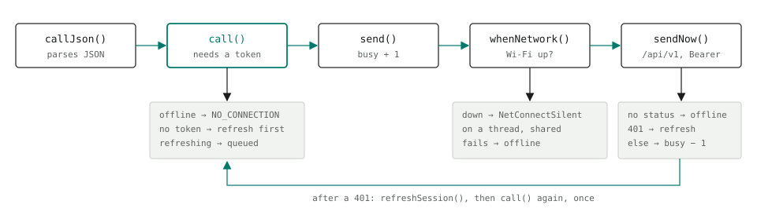
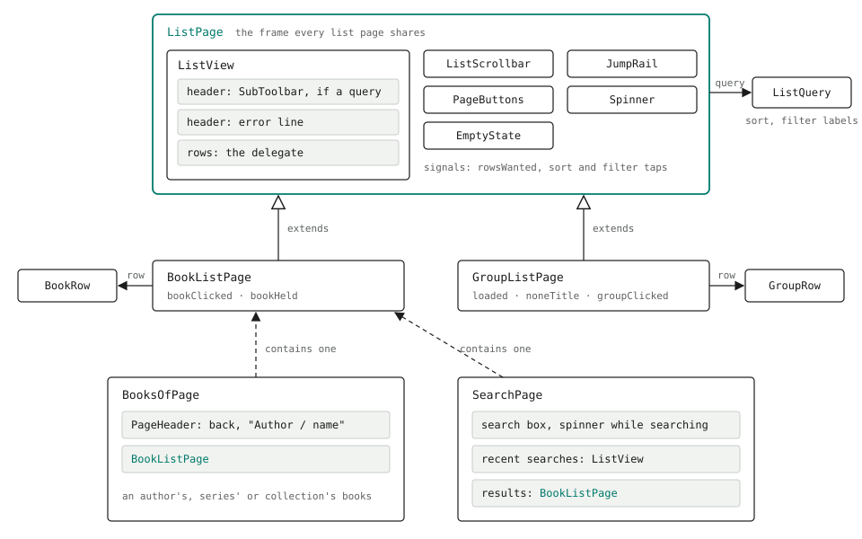

# How PBookOrbit works

Notes for working on the app: how it's put together, how it talks to BookOrbit, what it
stores on the device and how it fits into the PocketBook system. Build instructions are in
the [README](../README.md#development), and firmware and SDK findings are in
[NOTES.md](../NOTES.md).

- [How the code fits together](#how-the-code-fits-together)
- [List pages](#list-pages)
- [Signing in](#signing-in) and [Offline](#offline)
- [Local data](#local-data)
- [Downloads and existing books](#downloads-and-existing-books)
- [On the device](#on-the-device): home screen tile, updates, the screen, text size,
  diagnostics
- [Tests](#tests)
- [The BookOrbit API](#the-bookorbit-api)

## How the code fits together

### Objects QML can see

`main.cpp` builds the long-lived objects and gives them to QML as context properties.

The largest, `bookOrbit` (`BookOrbitClient`), owns one object per job and keeps them in
step: the session, theme, recent searches, details, three book lists and four group lists.
QML reaches them through it, as `bookOrbit.session.online` or `bookOrbit.collections.load()`.

Every request to the server goes through `Session`. Covers, Downloads and BookFinder take
the session rather than the whole client.


Helpers without state are namespaces or plain functions: `bookrecords` (companions,
variants, format files, sort keys), `formats.h`, `network`, `systemlibrary`, `zip`,
`saveFile`, `LauncherFiles`, `einkcolors` and `accents`.

### Book lists and group lists

There are two kinds of list:

- **Book lists** (`PagedBookList`) load the server's results a page at a time as rows
  scroll in.
- **Group lists** (`GroupList`: collections, series, authors) load every row at once and
  sort them locally. As each row comes into view they look up its books, saving what they
  find in `GroupDetails`, which lists of the same kind share.

Both own a `BookListModel` and expose `model`, `error` and `jumpSections`, so `ListPage`
binds to either the same way. Each starts a new generation when its query changes and
ignores replies to older ones. Offline, each list builds its rows from the downloaded
books.


### Libraries

`Session` holds the user's libraries and the book list's library: the one it used last
(`libraryId`) if the server still has it, otherwise the first. Saving it lets the book
list show that library's cached rows at startup, before the libraries are fetched. Find
books uses it too.

Every other list has its own library, or -1 for every library:

- Series and Authors: `GroupList::setLibrary()`, saved with `keepLibrary()`.
- An author's series, a books-of list and search: the `show()` or `setQuery()` argument,
  starting with every library each time.
- A collection: any library, since its books may be in several.

`Session::booksPath()` gives one library's endpoint or every library's (`/books/query`).
The series and authors endpoints take one `libraryId` or none, so those are the only
choices. A server with only one library always uses that library's endpoint
(`libraryToQuery()`), which has the A-Z sections.

Series and Authors wait for the libraries before loading, and forget a saved library the
server no longer has. Collections don't wait.

### Filters

`ListFilter` (`bookOrbit.filter`) holds the content type and Downloaded only. Every list
shares it, and it's saved. Search has its own, `bookOrbit.searchFilter`, which isn't
saved and copies the shared one at the start of each search.

### Requests

`Session` also holds the tokens, `online` and `busy`. A list request reconnects Wi-Fi if
it has gone idle, refreshes the access token when needed and retries once on a 401.
`request()` and `download()` don't set `busy`. `startStream()` refreshes the token first,
so it lasts through a large download.



### Keeping the parts in step

| When | Then | Connected in |
|---|---|---|
| First frame drawn | `start()`: reload the library (with the query QML set) and theme, if a session was saved | `main.cpp` |
| `Session::started` | `start()`, after signing in | `BookOrbitClient` |
| `Session::libraryChanged` | The book list reloads, showing that library's cached rows meanwhile | `BookOrbitClient` |
| `ListFilter::changed`, online or offline | The filter applies to the list in front, and to the others using it when next shown | QML |
| `Session::ended` | `clearLists()`: database caches, `GroupDetails` and every list emptied, before QML's handlers run | `BookOrbitClient` |
| Back online | Group lists forget the rows they built offline | `BookOrbitClient` |
| `bookOrbit.setLocalBooks()` | Every list takes the downloaded books; local-only lists relist | QML |
| `Downloads::downloaded` | `Details::loadBook`, saving the book's details for offline | `main.cpp` |
| `Details::savedBooksChanged` | `Downloads::entriesChanged`, so downloaded lists show the latest status | `main.cpp` |

## List pages

### The frame

Every list in the app shares one frame, `ListPage` (`src/qml/ListPage.qml`). It's a
ListView whose header is the sub-toolbar (when the page has a `ListQuery`) and an error
line, with a scrollbar, jump rail, page buttons, spinner and empty state over it. A page
opened over the views gives it a `title`, shown in a `PageHeader` with a back button.

It asks for rows as they come into view with `rowsWanted(first, last)`. It takes its sort
and filter labels, and the rail's direction, from its query, and goes back to the top
whenever the query changes.

A new sort or filter keeps the old rows until the server's first page arrives, and
everything that goes with them changes in the same frame, so the screen updates once. A
book list holds its new rail sections until then (`PagedBookList::showJumpSections()`).
After a tap on the sort icon, the icon keeps its pressed look and old direction, and the
rail its old order (`sortIconHeld`).

### Queries

A `ListQuery` has `sorts`, each `{name, field, descending}`, and gives the chosen
`sortField` and the content type's `formats` for the request. Its `filter` holds the
content type and Downloaded only: `bookOrbit.filter`, or search's own. Ebooks and
Audiobooks are checkboxes, and the last one ticked can't be unticked.

A query with `hasLibraries` adds a Libraries section above them (radio buttons, plus All
libraries with `allLibraries`) when the server has several libraries and can be reached.
Its filter button then names the library, or says Library while the libraries are
fetched. It sends `libraryChosen(id)` and leaves the view to act on it.

### Book and group pages

Two components extend the frame with their own row:

- `BookListPage` has a `BookRow` per book and reports taps and holds. The library, a
  books-of page (an author's, series' or collection's books) and the search results use
  it.
- `GroupListPage` has a `GroupRow` per group and reports taps. The Collections, Series and
  Authors tabs and an author's series use it.

Series and authors take the content type and Downloaded only (`GroupList::setQuery()`),
keeping the groups with matching books and counting only those. Filtering by format needs
every group's books looked up, so the spinner stays until then. Downloaded only uses the
downloaded books in the list's library.

`BooksOfPage` extends `BookListPage`, and `AuthorSeriesPage` extends `GroupListPage`, each
adding a title and model.



### Rows

`BookRow` and `GroupRow` both extend `ListRow`, the row layout, and fill its picture with
`Cover`: a group shows two, an author their `AuthorPortrait`. Both draw a `CoversImage`,
the cached cover or photo, which is asked for again when its download arrives.

### Spinner and empty state

The page that owns a list decides when its spinner and empty state show and what the empty
state says (`loading`, `empty`, `emptyTitle`, `emptyText`, with `offlineText()` for the
offline sentence). `GroupListPage` decides when for every group list, from `loaded`. An
error with no rows always shows as "Something went wrong".

### Search

`SearchPage` contains a `BookListPage` for its results, without sections and so without a
rail. Its sub-toolbar shows with the results, not over the recent searches.

A search ends on going back, opening a book or signing out, which resets its query. Pages
opened from the results keep it.

### Pages in main.qml

In `main.qml`, each list page has a `ListQuery` of its own, and `frontPage` is the first
visible page, checking the pages opened over the views before the footer's views. The
page-turn keys page its `pageButtons`, the sort and filter menus are placed by its `list`,
and they show its `query`, or the library's for a page without one.

A filter change bumps a revision: `filterRevision` for the lists' filter, `searchRevision`
for search's. Going online or offline does too, for a filter that isn't Downloaded only.
The change applies to the front page's query if it uses that filter. Any other query
applies it when its page is next in front, so hidden lists don't reload.

One set of menus (each page's `menus`, a `ListMenus`), the faded overlay and the book menu
serve every list page. One `RailLayout` (`railLayout`) puts every rail's letters at the
same height.


### Where they're tested

The frame is tested once, in `tests/qml/components/tst_listpage.qml`, and what each list
adds in `tst_booklistpage.qml` and `tst_grouplistpage.qml`. The rows are tested in
`tst_listrow.qml`, `tst_bookrow.qml`, `tst_grouprow.qml` and `tst_cover.qml`. A view's
feature file tests only what it wires itself: what it loads, its sorts and texts, and what
a tap opens.

## Signing in

The sign-in page asks for the server address (`books.example.com`; https is assumed
unless `http://` is typed), and the same username and password as the BookOrbit website.
After a successful sign-in the server is saved and shown as a pill. Builds can prefill a
server with `make release SERVER=...`.

Each device gets its own session, listed in the BookOrbit account as "PocketBook
<model>". The password isn't stored. The session's refresh token is, in the app's
database. Signing out ends the session on the server.

## Offline

### Online or not

The app counts as online until a request gets no reply: no connection, a refused one or a
time-out. Any reply means online.

Wi-Fi turns itself off when idle, so before each request the app reconnects it with
`NetConnectSilent()`. If that fails, the app is offline. Only things the user starts, such
as signing in or a download, show the system's Wi-Fi dialog (`NetConnect2()`).

While offline, requests fail at once with "No connection" instead of being sent, and
covers wait.

### Coming back online

The system's `EVT_NET_CONNECTED` doesn't reach the app (see NOTES.md), and polling would
cost battery. So the app checks whether Wi-Fi has connected (`QueryNetwork()`) when the
user taps or presses a key, at most every 3 seconds, and checks the server again once it
has. The user can also ask, with Reconnect or Connect (`goOnline()`).

A session refresh that fails offline keeps the session.

### Signed out with no network

The sign-in page shows "Currently offline" in place of the form, with a Connect button
(`goOnline()`) that shows the system's Wi-Fi dialog. It uses `networkConnected`, from
`QueryNetwork()`. The form comes back once the app is online.

A sign-in that gets no reply while the network is up keeps the form and says "The server
didn't reply".

### What changes offline

- A red badge with a crossed-out Wi-Fi sign follows the header's title.
- The header menu has Reconnect (`goOnline()`).
- Every list shows downloaded books only, with the switch for it turned on and disabled.
  Back online, each list goes back to the user's own setting.
- "Find books on this device" is hidden, since it needs the server's library.
- Author and book details show what was last saved.
- Empty lists say why in the middle of the page (`EmptyState.qml`), including when it's
  because the app is offline.

### Lists from downloaded books

QML hands the client the downloaded books (`setLocalBooks()`). Offline, the Series and
Authors views, an author's series and search are built from them:

- Rows built this way have negative ids, no author photos, and only the downloaded books'
  formats. Back online they count as not loaded, so each view fetches the server's rows
  when it next shows.
- Authors already fetched that session are kept, filtered to downloaded books. Authors
  take their id, sort name and photo from the `authors` table if they've been fetched
  before.
- Collections lists the saved collections that have downloaded books.

Set `PBOOKORBIT_OFFLINE=1` to run as though there were no network, for testing.

## Local data

### The database

Data lives in an SQLite database, `pbookorbit.db`, in the system config folder:
`/mnt/ext1/system/config` on the device, `build/pbookorbit/<sdk>/pc/system/config` in the
emulator. Set `PBOOKORBIT_DB` to use a different file, for example in tests. With the
device plugged in, `sqlite3 <mount>/system/config/pbookorbit.db` opens it from a PC.

| Table | Holds |
|---|---|
| `settings` | Key/value settings (below) |
| `books` | BookOrbit books by id, as their list entry in JSON |
| `book_files` | Files on the device (`path`) and their book (`book_id`), downloaded or found |
| `book_details` | Those books' full details (`GET /books/:id`), saved when a book downloads and whenever its Book info page loads them |
| `authors` | Authors by id, with the authors list's entry and their details (`GET /authors/:id`) as JSON, each saved when fetched |
| `collections`, `collection_books` | The user's collections in order, and each one's book ids, newest first |
| `list_cache` | What each list last showed |
| `group_details` | What looking up a series', collection's or author's books found |

`books.data` is JSON so that new fields don't need a schema change. `title` and `series`
are generated columns for querying. Add more with `ALTER TABLE books ADD COLUMN ...
GENERATED ALWAYS AS (json_extract(data, '$.field'))`.

Only downloaded books are cached at the moment. Their entries are replaced whenever they
appear in a list fetched from the server, so status and progress stay current. Deleting a
book's files leaves its cache entry in place.

### Settings

| Key | Value |
|---|---|
| `serverUrl`, `username`, `refreshToken` | The session |
| `libraryId` | The library the book list showed last |
| `seriesLibraryId`, `authorsLibraryId` | The libraries chosen for Series and Authors; absent for every library |
| `hideEbooks`, `hideAudiobooks`, `downloadedOnly` | 0/1, the filter every list shares |
| `accent` | The BookOrbit accent colour |
| `recentSearches` | JSON array |
| `findBooksOffered` | 0/1 |
| `diagnosticsLogging` | 0/1 |

Signing out forgets everything from `serverUrl` to `downloadedOnly`.

### Cached lists

`list_cache` keeps each list's last rows as JSON, by name:

- `library:<libraryId>`, `collections`, `series` and `authors`
- `booksOf:<field>:<values>` for an author's, series' or collection's books

Series, authors and books-of names end with `:<libraryId>` when they show one library.

A list shows these rows when first opened, until the server's arrive. A book list keeps
its first two screens of rows, with its sort and filter, and shows them only for the same
sort and filter. The 20 most recently loaded books-of pages are kept.

### Group details

`group_details` keeps what looking up a series', collection's or author's books found, by
kind and id. The kinds are `series`, `collections` and `authors`, with `:<libraryId>` for
one library's, since counts differ by library. Each entry has:

- the count, with an ebook and audiobook of the same book counted once
- the formats and the cover versions
- each book's formats, so a filtered list shows at once, before the lookups
- a collection's authors, and an author's books' series (for their info page)

Only rows that have been on screen are looked up, once each time their list loads,
starting with those in view. Series and authors are looked up about twenty to a request,
collections one at a time, since books don't say which collections they're in; a
collection's lookup also saves its book ids to `collection_books`. Filtering authors by
format needs every author's books, so choosing Ebooks or Audiobooks looks them all up.

Rows show the saved details until a lookup replaces them, and keep them if it fails. Once
a whole list has loaded, the details of rows no longer in it are deleted. `list_cache` and
`group_details` are cleared on signing out.

### Covers and photos

Covers and author photos are cached in `/mnt/ext1/system/cache/pbookorbit-covers`, named
`<book id>` or `author-<author id>`. Each has the download as it came,
`<name>-<version hash>-source`, and a PNG for each size drawn,
`<name>-<version hash>-<width>x<height>.png`. A name's files go in one of 256 folders,
`00` to `ff`, from a hash of the name, so no folder holds too many files and a cover's
versions are together.

Only one version is kept: a new download deletes the other version's files. Versions are
handled like this:

- A cover asked for without a version (the series list has none) uses whichever version
  was downloaded. A download without a version never replaces one with a version.
- A version deleted during the session, but still asked for by a list not yet refreshed,
  is served from the newer download, so two lists can't keep fetching it from each other.
- Offline, a cover or photo not cached at the size wanted is scaled from the download, or
  the largest cached copy of any version, and saved under that version's name. The current
  version is then still fetched once online.


### Reading dates from the system's library

BookOrbit's list entries have no last read date. For downloaded books, the Recently read
sort uses when the system's reader last opened each book's files, or its audiobook player
last played them. Books are newest first, sectioned by day, then the books never opened
by title.

The dates come from the firmware's library database,
`/mnt/ext1/system/explorer-3/explorer-3.db`, and the player's,
`/mnt/ext1/system/config/audiobooks/audiobooks.db`. Both are read only, and only on
firmware whose schemas have been checked: 6.10, by `GetSoftwareVersion()` (see
`src/core/systemlibrary.h`). Either database is used if the other can't be read. With
neither, or on other firmware, the sort is by title with no sections.

The firmware version is in the log at startup. NOTES.md has the schemas.

## Downloads and existing books

### Downloads

Ebooks download to `/mnt/ext1/Books` and audiobooks to `/mnt/ext1/Audio Books`. After each
download the app asks the system to rescan, so the book appears in the system library.
Ebooks open in the system reader, and audiobooks in the Audiobooks app
(`/ebrmain/bin/audio_books.app`).

### Find books on this device

"Find books on this device", in the header menu, scans Books, Audio Books and Downloads for
files the app hasn't recorded, such as books downloaded with KOReader. It marks the ones in
the library as downloaded. A file matches a library book if, checked in order:

1. KOReader's BookOrbit plugin, if installed, lists it for this server in its state file
   (`bookorbit_sync_state*.lua` in `applications/koreader/settings`), and the file hasn't
   changed.
2. Its partial MD5 matches a library file's. This is KOReader's hash
   (`util.partialMD5`), which BookOrbit stores for every file.
3. Its file name matches a library file's.

For 2 and 3, the candidates are books in the same format whose title appears in the file
name.

A file that has candidates but matches none of them is kept as an unsure match, with the
best candidate. An example is an older copy of a book whose file BookOrbit has since
rewritten with new metadata, changing its hash and name. Unsure matches are only logged
for now: the dialog says how many books it matched, and unsure ones count as not matched
until there's a list to confirm them in (see TODO.md). See `src/core/bookfinder.h`.

## On the device

### Home screen tile and task manager

On every start the app checks it has a PBookOrbit tile, with its own icon, on the
applications screen. The code is in `src/ui/launchertile.cpp`. NOTES.md covers the
`view.json` format and how the task manager picks names and icons.

- **Icons.** They're built into the app from the SVGs in `src/icons` (`make icons`), and
  written to `applications/icons/pbookorbit.bmp` and `pbookorbit_f.bmp` (focused) if
  they're missing. Replace them there to change the tile, or delete them to get the
  defaults back on the next start. On the Era Color they must be 110x110, 8-bit grey, or
  the tile won't line up.
- **The tile.** The app adds itself to the launcher's `system/config/desktop/view.json` as
  `U_pbookorbit`, at the end of the first group, after saving the original as
  `view.json.before-pbookorbit`. It only places the tile once, so moving or removing it on
  the device sticks.
- **Restart.** The launcher only reads `view.json` at boot, so the tile appears after a
  restart. The first time, the app explains this and offers to restart.
- **Task manager.** The running task is given the same name and icon, so the task manager
  shows PBookOrbit instead of `pbookorbit`.

### Updates

"Check for updates" in the header menu, signed in or out, asks GitHub for the app's
releases (`api.github.com/repos/cooperaj/pbookorbit/releases`, one request, connecting
Wi-Fi first) and says whether there's a newer one. Changelog opens the release's GitHub
page in the browser.

Update downloads the release's zip and checks it against the SHA-256 GitHub lists for it.
It unpacks it with `src/core/zipreader.h` (zlib, since Qt's zip reader is private API):
the new launcher straight over `applications/pbookorbit.app`, and the binary into
`pbookorbit/update/`. Restart now quits and has the launcher start the new version; Later
leaves it for the next start. See `src/core/updater.h`.

**Versions** are the build's `git describe` (the kit's `PB_APP_VERSION`), compared as
semantic versions with release tags such as `0.9.0-beta`. A build made after a tag counts
as that tag. Drafts are ignored, and pre-releases count until the app is 1.0.

**Release files** are `pbookorbit-<version>-<sdk>.zip`, one per SDK, such as
`pbookorbit-1.0.0-B300-6.10.zip`, made by `make release`. The app takes the file for its
own build's chip (B300, from the kit's `PB_SDK`) with the newest firmware no newer than the
device's. B288 and B300 devices get 6.11 firmware before there's a 6.11 SDK for them, so
they keep taking 6.10 builds until a 6.11 one is released. A newer release with no file
for the device is reported as not ready for it.

### The launcher

The app runs from `applications/pbookorbit/pbookorbit`, started by
`applications/pbookorbit.app`. That's a shell script (`src/launcher.sh`) modelled on
KOReader's launcher. After the app exits, the script:

- installs a binary left at `pbookorbit/update/pbookorbit`, keeping the old one as
  `pbookorbit.old`
- puts the old binary back if the new one fails within 30 seconds of starting, and
  otherwise deletes it once the new one has run
- starts the app again if it left a `pbookorbit/restart` file

It logs to `pbookorbit-launcher.log`, with the app's output. It passes its own path in
`PBOOKORBIT_LAUNCHER`, so the home screen tile starts the script rather than the binary.

### The screen

Every frame on e-ink is a slow screen update, so nothing should draw while the app is
idle. Anything that animates (a blinking cursor, `BusyIndicator`, transitions, Flickable
momentum) keeps the display busy and makes the whole device feel frozen. The diagnostics
log counts frames, which should be 0 when idle.

Updates that overlap queue: each waits until the panel has finished the one before, about
450 ms with the standard waveform. The app works around this in three places:

- **Scrolling.** A list switches to A2, the fast black-and-white mode, while it scrolls,
  and back once it stops (`A2Scrolling.qml`, `Eink::enterA2ForFlick()`).
- **Pressed looks.** A button's pressed look is drawn first and what the tap opens covers
  it, so every pressed look (buttons, menu rows, tappable info fields; see
  `PressArea.qml`) draws with the fast black-and-white waveform, about 240 ms
  (`Eink::requireFastUpdate()`). Taps that change nothing on screen, such as a book
  row's, don't ask for it, or the next screen and its covers would draw in black and
  white. It asks the platform plugin for `DynamicBW`, not `PartialBW`: the plugin keeps
  the highest-ranked type asked for since its last update, and `PartialBW` ranks below the
  default.
- **The keyboard.** The plugin's own update of the keyboard's area after it closes is
  turned off (`Eink::reduceKeyboardUpdates()`). The app redraws the whole window then
  anyway, and the extra update made everything after it wait about 0.4 s. The keyboard's
  word suggestions are hidden (`KBD_HIDE_SUGGESTIONS`): inkview redrew the whole keyboard
  after each key and waited for each suggestion's update, adding about 50 ms before the
  letter appeared. The keyboard draws its keys itself, with the standard waveform; no
  keyboard flag or plugin call changes that.

### Text size and accessibility

The app follows the system's text settings (Settings > Accessibility > Text & contrast) as
the firmware's own Qt apps do. `Accessibility` (`accessibility` in QML) reads them with the
SDK's `inkview/accessibility_text.h`, the same calls the firmware's Qt controls make:

- **Text size**, a percentage from 100 to 200, in steps as small as 1
- **Bold text**
- **Grey text contrast**
- **The font** (`iv_get_default_font()`), OpenDyslexic when chosen. With OpenDyslexic,
  inkview reports the size as 100, so its text isn't enlarged, in the system apps either.

A change reaches the running app as `EVT_CONFIGCHANGED`, and it reads them again. They're
stored in `system/config/global.cfg`, which the emulator reads too, so they can be tried
there: `textScale=150`, `boldTextEnabled=1`, `highContrastEnabled=1`,
`openDyslexicEnabled=1`.

Text is `StyledText`: a size from the type scale in `units.js` (the firmware's, from its
`FontStyles`), multiplied by the text size, in the system font, bold when bold text is on,
with lines closing up slightly as it grows. Grey text goes through `Units.grey()`, which
gives black when contrast is on; grey lines stay grey.

Layout follows the system apps at large sizes:

- List rows, info cells and wrapping text grow with the text (`Units.textScale()`).
- Toolbars, the sub-toolbar, buttons and menu rows keep their height and cut their text
  short. Menus widen to fit, up to the window's width.
- Icons, covers, section boxes and the jump rail's letters keep their size.

### Diagnostics log

`pbookorbit.log` is written to the root of the device's storage
(`build/pbookorbit/<sdk>/pc/system/mnt/ext1` in the emulator). It's cleared on each start,
except when the launcher starts the app again after an update, which adds to it.

- `diagnostics::log()` always writes, for errors and startup information.
- `diagnostics::trace()` only writes while diagnostics logging is on (tap the title six
  times).

With logging on, the log records:

- each request, with its status and timing
- Wi-Fi connections, and changes in the network state (`QueryNetwork()`, checked every 2
  seconds)
- the book list switching A2 on and off while scrolling, and updates asked to be HQ or
  fast (see `src/ui/eink.h`)
- every 10 seconds, the frames rendered, memory use (`VmRSS`), thread count and network
  state

### Logging screen updates

The firmware can log each update the platform plugin and inkview make, with its region,
type and any wait for the panel. Logging slows updates a little.

To turn it on, create `/tmp/p7` writable by the app, which doesn't run as root:
`mkdir /tmp/p7 && chmod 777 /tmp/p7`. It's cleared on restart. Then put this line in
`system/config/logger.cfg` on the device's storage, and start the app:

```
pbookorbit=/P7.Sink=FileTxt /P7.Pool=2048 /P7.Trc.Verb=0 /P7.Format="%lv {%tf} %ti [%fs:%fl] %mn %ms" /P7.Dir=/tmp/p7/ /P7.Roll=4mb /P7.Files=8
```

Delete the file to turn it off.

## Tests

### Running them

`make test` builds the app and the tests for PC, then runs the tests headless in the
kit's build container, on Qt's offscreen platform. It prints Qt's PASS/FAIL line for each
test and exits non-zero if any failed.

`make test-map` prints what the tests cover, from their names: each file's tests as
sentences, under the first sentence of its opening comment. A test's name is the sentence
it's listed as, so `test_failedDownloadCanBeTriedAgain` reads "Failed download can be
tried again".

### What's where

| Folder | Holds |
|---|---|
| `tests/unit/<name>/` | One C++ test program each, written with Qt Test (`tst_<name>.cpp`) |
| `tests/qml/app/` | Tests of the whole app, a file per thing a user does (`tst_gettingbooks.qml`) |
| `tests/qml/components/` | Tests of one component on its own |
| `tests/qml/helpers/` | `UiTestCase` and `AppTestCase`, which the QML tests build on |
| `tests/support/` | `FakeServer`, `FakeInkview` and `FakeKeyboard` |
| `tests/fixtures/` | The JSON and files the fake server replies with |
| `tests/appcore/` | Everything in `src/sources.pri`, the app without `main.cpp`, as a static library the tests link against |

In a C++ test every private slot is a test, a `<test>_data()` slot makes it data-driven,
and `QSignalSpy` records signals. QML tests use Qt Quick Test: every `tst_*.qml` under
`tests/qml/` is picked up, and each `test_*` function in one runs as a test. They import
the QML straight from `src/qml`.

### Adding a test

- **C++:** copy a folder under `tests/unit/`, rename its `.pro` and `.cpp`, and add it to
  `SUBDIRS` and the `depends` lines in `tests/tests.pro`.
- **QML:** add a `tst_<name>.qml` to a folder under `tests/qml/`, with an `AppTestCase` or
  `UiTestCase` (from `import "../helpers"`) whose `name` says what it covers.

### Writing tests

A test goes in the lowest layer where its subject is the whole story:

- `app/`: what a user can do, through the whole app. A file per goal, such as getting a
  book onto the device, not per page.
- `components/`: what a shared component promises that is awkward to reach through the
  app: layout, gestures, the edge cases of its inputs. Behaviour several views share is
  tested once, here or through one view, and each view's file keeps only its own wiring.
- `unit/`: logic on its own, as tables of inputs and results.

In `app/`, one test follows the main path from the user's first tap to the outcome, named
for what the user can do: `test_aUserCanDownloadABookAndReadIt`. A variant gets a test of
its own when its outcome differs, named for that outcome:
`test_aFailedDownloadCanBeTriedAgain`. A step on the way, such as a button showing or a
dialog opening, is part of the journey rather than a test. So is something not on offer,
checked where the user would look for it (no Delete in the menu of a book that isn't on
the device).

Tests act as the user does. They tap rows, and tap and wait for text by what the screen
says (`tapText("Delete")`, `expectText(...)`), keeping `objectName` for things without
text, such as icon buttons and lists. When choosing among options, they pick one that
isn't first, so the order alone can't pass.

They check what a user or the device would see: text on screen, a row's on-device mark,
files in `Books`, what the system was asked to open, and what is still there after
`reopen()`. They don't check the app's own records, such as `downloads.isOnDevice()` or a
page's properties. The exception is the requests sent to the server, where the point is
how few there are.

`make test-map` shows a file's tests as sentences; each should read as something the app
does.

### The test app

`tests/qml/main.cpp` sets up the globals the QML expects, as the app's `main.cpp` does,
with the app's real objects and image providers. It adds three of its own:

- `fakeServer`, the stand-in BookOrbit server on 127.0.0.1
- `inkview`, the fake inkview (see [inkview in tests](#inkview-in-tests))
- `keyboard`, the on-screen keyboard. `FakeKeyboard` takes the place of the offscreen
  platform's input context, which has none, so tapping a text field brings it up over the
  bottom of the window, as on the device, and `Qt.inputMethod` reports it.
  `keyboard.visible` and `keyboard.rect` say whether it's up and where.

`testApp.reset(settings, options)` replaces the app's objects with new ones on a new
database, in a new temporary folder that is also the working directory. `settings` go in
the database first, as though the app had been used before: `{serverUrl, username}` is a
signed-out user, and a `refreshToken` as well makes a saved session.

### The fake server

A test typically opens the app or a page, says what the server replies with, taps and
types, then waits for the result with `tryCompare` or `tryVerify`. `fakeServer` has:

| Call | Does |
|---|---|
| `respond(method, path, status, fixture, match)` | Replies with a fixture from `tests/fixtures/` |
| `respondJson(method, path, status, body, match)` | Replies with a body made in the test, such as a list of 60 series |
| `requests` | What the client sent |
| `reachable = false` | Refuses connections, as when the network is down |
| `hold(method, path)`, `release(method, path)` | Keeps those requests waiting until released, for acting while a reply is on its way |

With `match`, a reply is only for requests whose body has those fields, such as `{sort:
[{field: "author"}]}`, so one path can answer each sort or filter with its own fixture.
Objects and arrays in it need only be part of the body's, and the latest reply that
matches wins.

### UiTestCase

`UiTestCase` finds and uses items on screen. `under` is optional in each, and limits the
search to under that item instead of `root`.

| Function | Does |
|---|---|
| `find(name, under)` | The item with that `objectName` |
| `tap(name, under)` | Taps it |
| `type(name, text)` | Taps a field and types into it |
| `tapText(text, under)` | Taps the one visible place a text shows, such as a dialog's "Download" |
| `expectText(text, under)`, `expectNoText(text, under)` | Wait for a text to show or go. A `RegExp` matches text that changes, such as `/^Downloading /` |
| `signIn(server, username, password)` | Fills in and sends the sign-in form |
| `textSettings(scale, bold, contrast)` | Sets the system's text settings (see [Text size and accessibility](#text-size-and-accessibility)) |

### AppTestCase

`AppTestCase` adds `open(settings, options)`, which resets `testApp`, opens `main.qml` as
`root` in a window of its own and, once it's drawn, calls `bookOrbit.start()` as
`main.cpp` does. The options are:

| Option | Does |
|---|---|
| `offline: true` | Starts with no network, as `PBOOKORBIT_OFFLINE=1` does. `testApp.offline` turns it on or off while the app is open |
| `books` | Entries saved in the database first. A book with a `file`, such as `"dune.epub"`, is downloaded: the file is made in `Books`, or `Audio Books` for an audiobook |
| `files` | Book files in those folders that the app hasn't recorded, for Find books |
| `apps` | The system's apps for each format, for Open with: `{epub: [{app: "koreader.app", name: "KOReader"}]}` |
| `nightMode: true` | Starts with the system in night mode |
| `firmware` | The version `GetSoftwareVersion()` gives, such as `"U700k3.6.10.2359"`; none by default |
| `opened` | When the system's reader last opened files in `Books`, or its player last played files in `Audio Books`, by name: `{"dune.epub": "2026-11-14T10:00:00Z"}`. Made into the system's library and audiobook databases |

It also has helpers for common steps:

| Helper | Does |
|---|---|
| `savedSession` | Settings for a signed-in user of `fakeServer` |
| `serveLibrary(books, jumpBuckets)` | Has the server answer for the library with those fixtures (three books by default) |
| `openLibrary(books, jumpBuckets, options)` | Both, and opens the app on the library |
| `bookRow(title, listName)`, `titlesIn(list)` | Find a book's row; read a list's titles |
| `holdBook(title)` | Opens a row's menu without the second-long hold (`tst_bookmenu` holds for real once) |
| `groupRows(pageName)` | Reads a Collections, Series or Authors list as `"Dune (3), ..."` |
| `groupRow(pageName, name)`, `sortBy(pageName, option)` | Find a group's row; pick a sort |
| `lookedUp(field)` | The series or authors whose books have been asked for |
| `expectOnDevice(title, formats)`, `expectNotOnDevice(title)` | Wait for a row to mark those formats (`"epub, m4b"`) as on the device, or none |
| `expectOpenedInReader(file, app)`, `expectOpenedInPlayer(file)` | Wait for the app to ask the system to open that file, and nothing else |

### inkview in tests

The tests never call `InitInkview()`, so the inkview calls that would reach the device are
faked. `tests/support/fakeinkview.cpp` defines them. A function defined in the test
program takes the place of a shared library's, so the app's code calls these instead of
libinkview's. They're compiled against the SDK's `inkview.h`, so a fake whose signature
drifts from the real one won't build.

| Faked | How |
|---|---|
| Opening books and apps (`OpenBook()`, `OpenTask()`, `SetFileHandler()`) | Recorded as `inkview.openedBooks` (`[{path, app}]`) and `inkview.openedTasks` (`[{app, args}]`). Nothing opens |
| The library scan after a download or delete (`SendEventTo()`) | Counted as `inkview.libraryScans` |
| The system's apps for each format (`GetSupportedFileTypes()`, `GetLangText()`) | From the `apps` option |
| Theme icons (`GetResource()`) | A white 32x32 bitmap for every name, about a theme icon's size, so the real `ThemeImageProvider` works and buttons sized by their icon can be tapped |
| Night mode (`IvGetScreenModeInversion()` and the app capabilities) | From the `nightMode` option |
| Text settings (`iv_text_scale_percentage()`, `iv_text_bold_enabled()`, `iv_text_contrast_enabled()`) | Set with `textSettings()`; a test that sets them puts them back with `textSettings(100)` in its `cleanup()` |
| The firmware version (`GetSoftwareVersion()`) | From the `firmware` option |
| The device model and the task manager (`GetDeviceModel()`, `GetCurrentTask()`, `GetTaskInfo()`, `SetTaskParameters()`, `SetSubtaskInfo()`) | Fixed answers |
| `QueryNetwork()` | Connected unless `testApp.offline` |

Every other inkview call is the real one. Pure ones such as `adjustAreaDefault()` and
`NewBitmap8()` work without `InitInkview()`; anything that talks to the system needs a
fake added.

The client's network calls are left out of the PC build anyway, so `PBOOKORBIT_OFFLINE` is
what turns its network off. On the PC build, inkview's storage paths (`FLASHDIR`,
`CONFIGPATH`) are relative to the working directory, which is why `testApp` runs in a
temporary folder. The client's log has no folder there, so it goes to the test output.

## The BookOrbit API

BookOrbit's API isn't documented. This comes from its source (`server/src/modules/`, types
in `packages/types/src/`), its web client (`client/src`) and testing against a server.

- Base URL: `<server>/api/v1`
- Errors are in NestJS format: `{"statusCode": 401, "message": "Invalid credentials"}`,
  where `message` may also be an array.

### Sessions

`POST /auth/login` with `{"username", "password", "clientKind": "native", "deviceLabel"}`
returns `NativeCredentials` and the user:

```json
{"accessToken": "...", "accessTokenExpiresAt": "...", "refreshToken": "<64 hex>",
 "refreshTokenExpiresAt": "...", "sessionId": 17, "user": {...}}
```

`clientKind: "native"` returns the refresh token in the body. Without it the server sets
browser cookies instead.

- Access tokens last about 15 minutes. Send them as `Authorization: Bearer <accessToken>`.
- Refresh tokens last 7 days. `POST /auth/refresh` with `{"refreshToken"}` returns new
  `NativeCredentials` with a new refresh token, and the old one stops working shortly
  after. Always save the new one, and never run two refreshes at once.
- `POST /auth/logout` with `{"refreshToken"}` ends the session.
- Login is limited to 5 attempts a minute.

On a 401 the client refreshes and retries the request once.

### Libraries and books

- `GET /libraries` returns the user's libraries, `[{id, name, bookCount, ...}]`, in the
  user's order.
- `POST /libraries/:id/books` takes a `BookQuery` (`packages/types/src/query.ts`) and
  returns a page of books:

  ```json
  {"sort": [{"field": "addedAt", "dir": "desc"}], "pagination": {"page": 1, "size": 20},
   "q": "optional search text", "filter": {"optional": "GroupRule"}}
  ```

  The response is `{items, total, page, size}`. Items include `id`, `libraryId`, `title`,
  `authors`, `seriesName`, `seriesIndex`, `files: [{id, format, role, sizeBytes}]`,
  `hasCover`, `readingProgress` and `readStatus`. Sort fields are listed in
  `StaticSortField`.
- `POST /books/query` takes the same query across every library the user can see. It has
  no jump buckets, and its title order uses a sort title the items don't include, so
  lists from it sorted by title or author have no A-Z sections.
- `POST /libraries/:id/books/jump-buckets` takes the same query plus `maxBuckets` (8 to
  64) and returns `{buckets: [{key, label, index, isUnknown}], kind, granularity}`, each
  bucket's `index` being its first row.
  - Letter sorts give the A-Z rail's sections.
  - Date sorts give `kind: "temporal"` buckets by day, month or year (`granularity`, the
    finest that fits), in the user's time zone, with an `isUnknown` bucket last for books
    with no date.
  - List entries have no last read date (`lastReadAt` is the latest
    `reading_progress.last_read_at` of the book's files), so these buckets are the only
    way to section the Recently read sort.
- `GET /books/:id` returns a single book in full, including each file's `filename` and
  `fileHash`.
- `GET /books/:id/thumbnail` returns the cover.
- `GET /books/files/:fileId/download` downloads a file.

### Collections

- `GET /collections` returns the user's collections and other users' public ones, in the
  user's order: `[{id, name, icon, displayOrder, bookCount, ...}]`.
- `POST /collections/:id/books/query` and `.../jump-buckets` work like the library
  equivalents, with an extra `collectionOrder` sort.

### Authors and series

- `GET /authors?libraryId=&sort=name&order=asc&page=&size=` lists a library's authors, or
  every library's without `libraryId`.
- `GET /authors/:id` returns one author, including `name`, `sortName`, `description`
  (plain text), `bookCount`, `birthDate`/`birthYear`, `deathDate`/`deathYear`, `website`,
  `genres` and `imageUrl`.
- `GET /series?libraryId=&sort=name&order=asc&page=&size=` lists a library's series, or
  every library's without `libraryId`. Each has `libraryNames` for the libraries it's in
  and `coverBookIds` for its covers, but no cover versions, formats or ebook and audiobook
  pairs. The client gets those from the series' books: `POST /books/query` (or the list's
  library's) filtered on `series includesAny [names]`.
- `GET /series?libraryId=&author=<text>` lists series with any author whose name contains
  the text, ignoring case. `author=Martin` matches every Martin, so the client filters to
  series whose `authors` include the exact name.

### Preferences

- `GET /user-preferences/theme` returns `{settings: {theme, accent, ...}}`, or
  `{settings: null}` if the user has never synced their theme. The app reads the accent
  colour from it.
