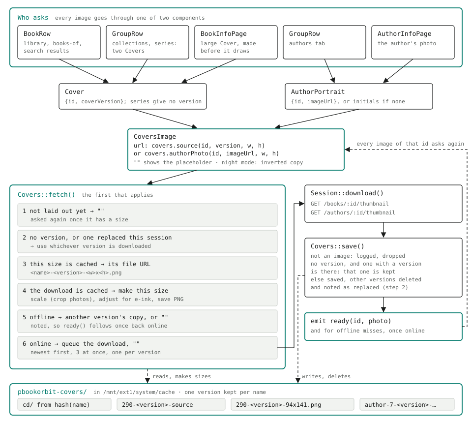
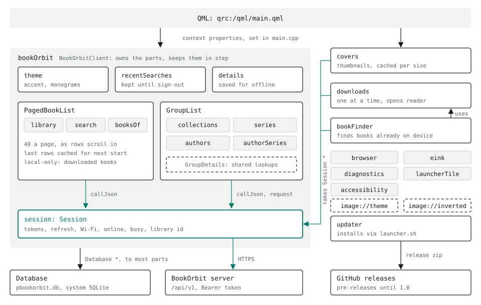
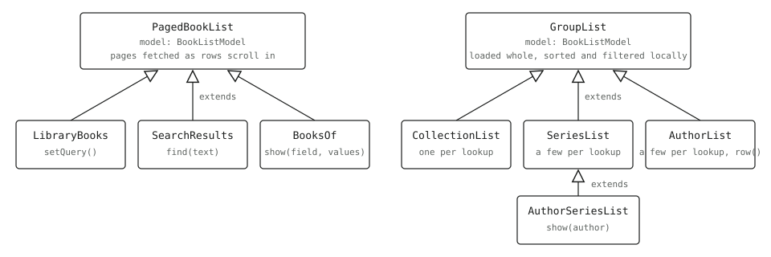
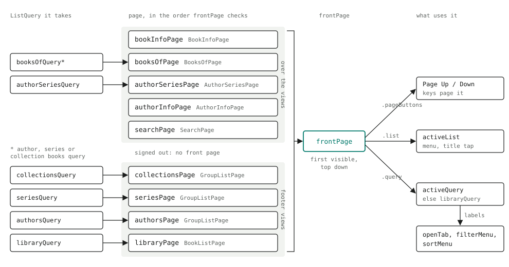

# How PBookOrbit works

Notes for working on the app: how it talks to BookOrbit, what it stores on the device,
and how it hooks into the PocketBook launcher. Build instructions are in the
[README](../README.md#development), and firmware and SDK findings are in
[NOTES.md](../NOTES.md).

## Signing in

The sign-in page asks for the server address (`books.example.com`, with https assumed
unless `http://` is typed), plus the same username and password as the BookOrbit website.
After a successful sign-in the server is saved and shown as a pill. Builds can prefill a server with `make release SERVER=...`.

Each device gets its own session, listed in the BookOrbit account as "PocketBook <model>".
The password isn't stored; the session's refresh token is, in the app's database. Signing
out ends the session on the server.

## Offline

The app counts as online until a request gets no reply: no connection, a refused one, or
a time-out. Wi-Fi turns itself off when idle, so before each request the app reconnects
it with `NetConnectSilent()`, and failing that it's offline. Only things the user starts
(signing in, a download) show the system's Wi-Fi dialog (`NetConnect2()`).

While offline, requests fail at once with "No connection" instead of being sent, and
covers wait. The app checks the server again when Wi-Fi has connected, which it looks
for (`QueryNetwork()`) when the user taps or presses a key, at most every 3 seconds, since the system's
`EVT_NET_CONNECTED` doesn't reach it (see NOTES.md) and polling would cost battery, or when
the user asks (`goOnline()`); any reply means online.
A session refresh that fails offline keeps the session.

Signed out with no network (`networkConnected`, from `QueryNetwork()`), the sign-in page
shows "Currently offline" in place of the form, with a Connect button (`goOnline()`) that
shows the system's Wi-Fi dialog. The form comes back once the app is online. A sign-in
that gets no reply while the network is up keeps the form, with "The server didn't reply".

Offline, a red badge with a crossed-out Wi-Fi sign follows the header's title, the header menu has
Reconnect (`goOnline()`), and every list shows downloaded
books only, with the switch for it turned on and disabled. Back online, each list goes
back to the user's own setting. Empty lists say so in the middle of the page, with a line
on why (`EmptyState.qml`), saying when it's because the app is offline.

QML hands the client the downloaded books (`setLocalBooks()`), and offline the Series and
Authors views, an author's series and search are built from them. Rows built this way have
negative ids, no author photos, and only the downloaded books' formats; back online they
count as not loaded, so each view fetches the server's rows when it next shows. Authors
already fetched that session are kept, filtered to downloaded books. Authors take their
id, sort name and photo from the `authors` table where they've been fetched before, and
Collections lists the saved collections that have downloaded books. Author and book
details show what was last saved. "Find books on this
device" is hidden offline, since it needs the server's library.

Set `PBOOKORBIT_OFFLINE=1` to run as though there were no network, for testing.

## Local data

Data lives in an SQLite database, `pbookorbit.db`, in the system config folder
(`/mnt/ext1/system/config` on the device, `build/pbookorbit/<sdk>/pc/system/config` in
the emulator). Set `PBOOKORBIT_DB` to use a different file, for example in tests. With
the device plugged in, `sqlite3 <mount>/system/config/pbookorbit.db` opens it from a PC.

- `settings` is key/value: `serverUrl`, `username`, `refreshToken`, `libraryId` (the
  library chosen for the book list), `seriesLibraryId` and `authorsLibraryId` (the
  libraries chosen for Series and Authors, absent for all of them), `hideEbooks`,
  `hideAudiobooks` and `downloadedOnly` (0/1, the filter every list shares), all
  forgotten on signing out, `accent` (the BookOrbit accent colour), `recentSearches`
  (JSON array), `findBooksOffered` (0/1) and `diagnosticsLogging` (0/1).
- `books` caches BookOrbit books by id. `data` holds the book's list entry as JSON, so
  new fields don't need a schema change. `title` and `series` are generated columns for
  querying; more can be added with
  `ALTER TABLE books ADD COLUMN ... GENERATED ALWAYS AS (json_extract(data, '$.field'))`.
- `book_files` maps files on the device (`path`) to books (`book_id`), whether downloaded
  or found.

- `book_details` keeps those books' full details (`GET /books/:id`), saved when a book
  downloads and whenever its Book info page loads them.
- `authors` keeps BookOrbit authors by id, with the authors list's entry and their
  details (`GET /authors/:id`) as JSON, each saved when fetched.
- `collections` and `collection_books` keep the user's collections in order, and each
  one's book ids, newest first.
- `list_cache` keeps what each list last showed, by name (`library`, `collections`,
  `series`, `authors`, and `booksOf:<field>:<values>` for an author's, series' or
  collection's books, with `:<libraryId>` after the series, authors and books-of names
  when they show one library), as JSON. Choosing another library for the book list
  empties `library`. A list shows these rows when first opened, until the
  server's arrive. A book list keeps its first two screens of rows, with its sort and
  filter, and shows them only for the same ones. The 20 books-of pages loaded most
  recently are kept.
- `group_details` keeps what looking up a series', collection's or author's books found,
  by kind (`series`, `collections`, `authors`, with `:<libraryId>` for one library's, as
  counts differ by library) and id: the count with an ebook and
  audiobook as one, the formats, the cover versions, a collection's authors, and an
  author's books' formats and series (for the format filter and their info page). Only
  rows that have been on screen are looked up, each once per time their list loads,
  starting with those in view: series and authors about twenty to a request, collections
  one each (books don't say which collections they're in), saving the collection's book
  ids to `collection_books` too. Filtering the authors by format needs every author's
  books, so choosing Ebooks or Audiobooks looks them all up. Once a whole list has loaded,
  the details of rows no longer in it are deleted. Rows
  show the saved details until then, and keep them if the lookup fails. `list_cache` and
  `group_details` are cleared on signing out.

Only downloaded books are cached at the moment. Their entries are replaced whenever they
appear in a list fetched from the server, so status and progress stay current. Deleting a book's files leaves its cache
entry in place.

Covers and author photos are cached in `/mnt/ext1/system/cache/pbookorbit-covers`, named
`<book id>` or `author-<author id>`: the download as it came, `<name>-<version hash>-source`,
and a PNG for each size drawn, `<name>-<version hash>-<width>x<height>.png`. Each name's
files go in one of 256 folders, `00` to `ff`, from a hash of the name, so no folder holds
too many files and a cover's versions are in one place.
Only one version is kept: a new download deletes the other version's files. A cover asked
for without a version (the series list has none) uses whichever version was downloaded, and
a download without a version never replaces one with. A version deleted during the session
but still asked for by a list not yet refreshed is served from the newer download, so two
lists can't keep fetching it from each other. Offline, a cover or photo not cached at the
size wanted is scaled from the download, or the largest cached copy, of whatever version,
and saved under that version's name, so the current version is still fetched once online.



### The system's library

BookOrbit's list entries have no last read date, so for downloaded books the Recently read
sort uses when the system's reader last opened each book's files, or its audiobook player
last played them, newest first, sectioned by day, then the books never opened by title.
It comes from the firmware's library database, `/mnt/ext1/system/explorer-3/explorer-3.db`,
and the player's, `/mnt/ext1/system/config/audiobooks/audiobooks.db`, read only, and only
on firmware whose schemas have been checked (6.10, by `GetSoftwareVersion()`; see
`src/core/systemlibrary.h`). Either database is used if the other can't be read; with
neither, or on other firmware, the sort is by title with no sections. The firmware version is in the log at startup. NOTES.md has the schema.

## Downloads and existing books

Ebooks download to `/mnt/ext1/Books` and audiobooks to `/mnt/ext1/Audio Books`. After
each download the app asks the system to rescan, so the book appears in the system
library. Ebooks open in the system reader and audiobooks in the Audiobooks app
(`/ebrmain/bin/audio_books.app`).

"Find books on this device" in the header menu scans Books, Audio Books and Downloads for
files the app hasn't recorded (books downloaded with KOReader, for instance) and marks the
ones in the library as downloaded. A file matches a library book if, checked in order:

1. KOReader's BookOrbit plugin (if installed) lists it for this server in its state file
   (`bookorbit_sync_state*.lua` in `applications/koreader/settings`), and the file
   hasn't changed.
2. Its partial MD5 matches a library file. This is KOReader's hash
   (`util.partialMD5`), which BookOrbit stores for every file.
3. Its file name matches a library file's.

For 2 and 3, the candidates are books in the same format whose title appears in the file
name. A file that has candidates but matches none of them either way is kept as an unsure
match, the best candidate, such as an older copy of a book whose file BookOrbit has since
rewritten with new metadata, changing its hash and name. Unsure matches are only logged for
now: the dialog says how many books it matched, and they count as not matched until there's
a list to confirm them in (see TODO.md). See `src/core/bookfinder.h`.

## Home screen tile and task manager

On every start the app checks it has a PBookOrbit tile, with its own icon, on the
applications screen.

- The icons are built into the app from the SVGs in `src/icons` (`make icons`) and
  written to `applications/icons/pbookorbit.bmp` and `pbookorbit_f.bmp` (focused) if
  they're missing. Replace them there to change the tile, or delete them to get the
  defaults back on the next start. On the Era Color they need to be 110x110, 8-bit grey,
  or the tile won't line up.
- The app adds itself to the launcher's `system/config/desktop/view.json` as
  `U_pbookorbit`, at the end of the first group, after saving the original as
  `view.json.before-pbookorbit`. It only places the tile once, so moving or removing it
  on the device sticks.
- The launcher only reads `view.json` at boot, so the tile appears after a restart. The
  first time, the app explains this and offers to restart.
- The running task is given the same name and icon, so the task manager shows PBookOrbit
  instead of `pbookorbit`.

The code is in `src/ui/launchertile.cpp`. NOTES.md covers the `view.json` format and how
the task manager picks names and icons.

## Updates

"Check for updates" in the header menu, signed in or out, asks GitHub for the app's
releases (`api.github.com/repos/cooperaj/pbookorbit/releases`, one request, connecting
Wi-Fi first) and says whether there's a newer one. Changelog opens the release's GitHub
page in the browser. Update downloads the release's zip, checks it against the SHA-256
GitHub lists for it, and unpacks it (`src/core/zipreader.h`, zlib, since Qt's zip reader is
private API): the new launcher straight over `applications/pbookorbit.app`, and the binary
into `pbookorbit/update/`. Restart now quits and has the launcher start the new version;
Later leaves it for the next start. See `src/core/updater.h`.

- **Versions** are the build's `git describe` (the kit's `PB_APP_VERSION`), compared as
  semantic versions with release tags such as `0.9.0-beta`. A build made after a tag
  counts as that tag. Drafts are ignored, and pre-releases count until the app is 1.0.
- **Release files** are `pbookorbit-<version>-<sdk>.zip`, one per SDK, e.g.
  `pbookorbit-1.0.0-B300-6.10.zip`, made by `make release`. The app takes the file for its own build's chip
  (B300 from the kit's `PB_SDK`) with the newest firmware no newer than the device's.
  B288 and B300 devices get 6.11 firmware before there's a 6.11 SDK for them, so they keep
  taking 6.10 builds until a 6.11 one is released. A newer release with no file for the
  device is reported as not ready for it.

The app runs from `applications/pbookorbit/pbookorbit`, started by
`applications/pbookorbit.app`, a shell script (`src/launcher.sh`, modelled on KOReader's
launcher). After the app exits, the script installs a binary left at
`pbookorbit/update/pbookorbit` (keeping the old one as `pbookorbit.old`), and starts the
app again if it left a `pbookorbit/restart` file. If a new binary fails within 30 seconds
of starting, it puts the old one back; otherwise it deletes the old one once the new one has
run. It logs to `pbookorbit-launcher.log`,
with the app's output, and passes its own path in `PBOOKORBIT_LAUNCHER` so the home screen
tile starts the script rather than the binary.

## Diagnostics log

`pbookorbit.log` is written to the root of the device's storage
(`build/pbookorbit/<sdk>/pc/system/mnt/ext1` in the emulator) and cleared on each start,
except when the launcher starts the app again after an update, which appends to it.
`diagnostics::log()` always writes, for errors and startup information.
`diagnostics::trace()` only writes while diagnostics logging is on (tap the title six
times). It records each request with status and timing, Wi-Fi connections and changes in
the network state (`QueryNetwork()`, checked every 2 seconds), the book list switching A2
on and off while scrolling (see `src/ui/eink.h`), and every 10 seconds the frames rendered,
memory use (`VmRSS`), thread count and network state.

Every frame on e-ink is a slow screen update, so `frames` should be 0 when the app is
idle. Anything that animates (a blinking cursor, `BusyIndicator`, transitions, Flickable
momentum) keeps the display busy and makes the whole device feel frozen.

## C++ objects

`main.cpp` builds the long-lived objects and gives them to QML as context properties. The
largest, `bookOrbit` (`BookOrbitClient`), owns one object per job and keeps them in step:
the session, theme, recent searches, details, three book lists and four group lists. QML
reaches them through it, as `bookOrbit.session.online` or `bookOrbit.collections.load()`.
Every request to the server goes through `Session`, which Covers, Downloads and BookFinder
also take, rather than the whole client.



The book lists (`PagedBookList`) load the server's results a page at a time as rows
scroll in. The group lists (`GroupList`) load every row at once, sort them locally, and
look up each row's books as it comes into view, saving what they find in `GroupDetails`,
which lists of the same kind share. Both own a `BookListModel` and expose `model`, `error`
and `jumpSections`, so `ListPage` binds to either the same way. Each starts a new
generation when its query changes and ignores replies to older ones. Offline, each list
builds its rows from the downloaded books.



`Session` holds the tokens, `online`, `busy`, the user's libraries and the book list's
library: the one saved in `libraryId` if the server still has it, otherwise the first.
Find books uses it too. Each other list has its own library, or -1 for every library: a
group list's `setLibrary()`, which Series and Authors save (`keepLibrary()`), and the
books-of list's `show()` argument or the search's `setQuery()`. An author's series,
books-of lists and search start with every library each time. `Session::booksPath()` gives one library's endpoint or
every library's (`/books/query`); the series and authors endpoints take one `libraryId`
or none, so those are the only choices. A server with one library always uses its own
endpoint (`libraryToQuery()`), for the A-Z sections. Group lists wait for the libraries
before loading, and forget a saved library the server no longer has. `ListFilter`
(`bookOrbit.filter`) holds the content type and Downloaded only, shared by every list
and saved. Search has its own (`bookOrbit.searchFilter`), unsaved, which copies the
shared one as each search starts. A list request reconnects
Wi-Fi if it has gone idle, refreshes the access token when needed and retries once on a
401. `request()` and `download()` don't set `busy`, and `startStream()` refreshes the
token first so it outlasts a large download.


These keep the parts in step:

| When | Then | Connected in |
|---|---|---|
| First frame drawn | `start()`: reload the library, with the query QML set, and theme, if a session was saved | `main.cpp` |
| `Session::started` | `start()`, after signing in | `BookOrbitClient` |
| `Session::libraryChanged` | The book list reloads without its cached rows | `BookOrbitClient` |
| `ListFilter::changed`, back online | The filter applies to the list in front, and to the others when next shown | QML |
| `Session::ended` | `clearLists()`: database caches, `GroupDetails` and every list emptied, before QML's handlers run | `BookOrbitClient` |
| Back online | Group lists forget the rows they built offline | `BookOrbitClient` |
| `bookOrbit.setLocalBooks()` | Every list takes the downloaded books; local-only lists relist | QML |
| `Downloads::downloaded` | `Details::loadBook`, saving the book's details for offline | `main.cpp` |
| `Details::savedBooksChanged` | `Downloads::entriesChanged`, so downloaded lists show the latest status | `main.cpp` |

Helpers without state live in namespaces or plain functions: `bookrecords` (companions,
variants, format files, sort keys), `formats.h`, `network`, `systemlibrary`, `zip`,
`saveFile`, `LauncherFiles`, `einkcolors` and `accents`.

## List pages

Every list in the app shares one frame, `ListPage` (`src/qml/ListPage.qml`): a ListView
whose header is the sub-toolbar (when the page has a `ListQuery`) and an error line, then
a scrollbar, jump rail, page buttons, spinner and empty state. A page opened over the
views gives it a `title`, shown in a `PageHeader` with a back button. It asks for rows as
they come into view with `rowsWanted(first, last)`, and takes its sort and filter labels,
and the rail's direction, from its query, going back to the top whenever the query
changes. A query's `sorts` are `{name, field, descending}`, and it gives the chosen
`sortField` and content type `formats` for the request. The content type and Downloaded
only are every query's `filter`: `bookOrbit.filter`, or search's own. Ebooks and Audiobooks are checkboxes, and the last one ticked can't be unticked. A query with `hasLibraries` puts a
Libraries section (radio buttons, plus All libraries with `allLibraries`) above them
when the server has several and can be reached, and its filter button then names the
library; it says `libraryChosen(id)` and leaves the view to act on it. Two components extend it with
their row:

- `BookListPage` has a `BookRow` per book and reports taps and holds. The library, a
  books-of page (an author's, series' or collection's books) and the search results use
  it.
- `GroupListPage` has a `GroupRow` per group and reports taps. The Collections, Series and
  Authors tabs and an author's series use it. Series and authors take the content type
  and Downloaded only (`GroupList::setQuery()`), keeping groups with matching books and
  counting only those. A format needs every group's books looked up, so the spinner
  stays until then; Downloaded only uses the downloaded books in the list's library.

`BookRow` and `GroupRow` both extend `ListRow`, the row layout, and fill its picture with
`Cover` (a group shows two, an author their `AuthorPortrait`). Both draw a `CoversImage`, the
cached cover or photo, asked for again when its download arrives.


The page that owns a list decides when its spinner and empty state show and what the
empty state says (`loading`, `empty`, `emptyTitle`, `emptyText`, with `offlineText()` for
the offline sentence); `GroupListPage` decides when for every group list from `loaded`.
An error with no rows always shows as "Something went wrong". `BooksOfPage`
extends `BookListPage`, and `AuthorSeriesPage` extends `GroupListPage`, each adding a title
and model. `SearchPage` contains a `BookListPage` for its results, unsectioned and so with
no rail. Its sub-toolbar shows with the results, not over the recent searches. A search
ends on going back, opening a book or signing out, which resets its query; pages opened
from the results keep it.

In `main.qml`, each list page has a `ListQuery` of its own, and `frontPage` is the first
visible page, checking the pages opened over the views before the footer views. The
page-turn keys page its `pageButtons`, the sort and filter menus are positioned by its
`list`, and they show its `query`, or the library's for a page without one. A filter
change bumps `filterRevision` and applies to the front page's query; any other query
applies it when its page is next in front, so hidden lists don't reload. One set of
menus (each page's `menus`, a `ListMenus`), the faded overlay and the book menu serve every
list page, and one `RailLayout` (`railLayout`) puts every rail's letters at the same
height.



The frame's behaviour is tested once, in `tests/qml/components/tst_listpage.qml`, and
what each list adds in `tst_booklistpage.qml` and `tst_grouplistpage.qml`; the rows in
`tst_listrow.qml`, `tst_bookrow.qml`, `tst_grouprow.qml` and `tst_cover.qml`. A view's
feature file tests only what it wires itself: what it loads, its sorts and texts, and what
a tap opens.

## Tests

`make test` builds the app and the tests for PC, then runs the tests headless in the kit's
build container, on Qt's offscreen platform. It prints Qt's PASS/FAIL line for each test
and exits non-zero if any failed. Everything is under `tests/`:

- `tests/unit/<name>/` holds one C++ test program each, written with Qt Test
  (`tst_<name>.cpp`). Every private slot is a test; a `<test>_data()` slot makes it
  data-driven, and `QSignalSpy` records signals.
- `tests/qml/` holds the QML tests, written with Qt Quick Test. Every `tst_*.qml` in it
  or its subfolders is picked up, and every `test_*` function in one runs as one test.
  `app/` tests the whole app, a file per thing a user does (`tst_gettingbooks.qml`), and
  `components/` tests one component on its own. They import the QML from `src/qml` directly.
- `tests/support/` has `FakeServer`, a stand-in BookOrbit server on 127.0.0.1, and
  `FakeInkview`, stand-ins for the inkview calls that would reach the device (see
  below). `tests/fixtures/` has the JSON and files the server replies with.
- `tests/appcore/` builds everything in `src/sources.pri`, the app without `main.cpp`,
  as a static library the tests link against.

`make test-map` prints what the tests cover, from their names: each file's tests as
sentences, under the first sentence of its opening comment. A test's name is the sentence
it's listed as, so `test_failedDownloadCanBeTriedAgain` reads "Failed download can be tried
again".

`tests/qml/main.cpp` sets up the globals the QML expects, as the app's `main.cpp` does,
with the app's real objects and image providers. `testApp.reset(settings, options)`
replaces the objects with new ones on a new database, in a new temporary folder that is
also the working directory. `settings` go in the database first, as though the app had
been used before: `{serverUrl, username}` is a signed-out user, and a `refreshToken` as
well makes a saved session. `fakeServer` is the fake server, `inkview` the fake
inkview, and `keyboard` the on-screen keyboard: `FakeKeyboard` (`tests/support/`) takes the
place of the offscreen platform's input context, which has none, so a text field's tap
brings it up over the bottom of the window, as on the device, and `Qt.inputMethod` reports
it. `keyboard.visible` and `keyboard.rect` say whether it's up and where.

Tests build on two types in `tests/qml/helpers/`. `UiTestCase` finds items by `objectName`
under its `root`, or under another item, with `find(name, under)`, and has `tap(name,
under)`, `type(name, text)` and `signIn(server, username, password)`. It also works by the
text on screen: `tapText(text, under)` taps the one visible, on-screen place a text shows,
such as a dialog's "Download", and `expectText(text, under)` and `expectNoText` wait for
one to show or go; a `RegExp` matches text that changes, e.g. `/^Downloading /`.
`AppTestCase` adds `open(settings, options)`, which resets `testApp`, opens `main.qml` as `root` in a window
of its own, and once it's drawn calls `bookOrbit.start()` as `main.cpp` does. `options`
can have `offline: true`, to start with no network as `PBOOKORBIT_OFFLINE=1` does
(`testApp.offline` turns it on or off while the app is open); `books`, entries saved in
the database first, where a book with a `file`, e.g. `"dune.epub"`, is downloaded, the
file made in `Books`, or `Audio Books` for an audiobook; `files`, book files there the app
hasn't recorded, for "Find books"; `apps`, the system's apps for each format, e.g. `{epub:
[{app: "koreader.app", name: "KOReader"}]}`, for Open with; `nightMode: true`, to
start with the system in night mode; `firmware`, the version `GetSoftwareVersion()` gives,
e.g. `"U700k3.6.10.2359"` (none by default); and `opened`, when the system's reader last
opened book files in `Books`, or its player last played files in `Audio Books`, by name,
e.g. `{"dune.epub": "2026-11-14T10:00:00Z"}`, made into the system's library and
audiobook databases with the tables the app reads. `savedSession` is a signed-in user of `fakeServer`,
`serveLibrary(books, jumpBuckets)` has the server answer for the library with those
fixtures (three books by default), and `openLibrary(books, jumpBuckets, options)` does
both and opens the app on the library. For the books in a list, `bookRow(title, listName)`
finds a row, `titlesIn(list)` reads the titles, and `holdBook(title)` opens a row's menu
without the second-long hold (`tst_bookmenu` holds for real once). For the Collections,
Series and Authors lists, `groupRows(pageName)` reads the rows as `"Dune (3), ..."`,
`groupRow(pageName, name)` finds one, `sortBy(pageName, option)` picks a sort, and
`lookedUp(field)` lists the series or authors whose books have been asked for.
`expectOnDevice(title, formats)` waits for a row to mark those formats, e.g. `"epub, m4b"`,
as on the device, and `expectNotOnDevice(title)` for none. `expectOpenedInReader(file,
app)` and `expectOpenedInPlayer(file)` wait for the app to ask the system to open that
file, and nothing else. A test typically opens the app or page, says what
the server replies with `fakeServer.respond(method, path, status, fixture, match)`, taps
and types, then waits for the result with `tryCompare` or `tryVerify`. With `match`, a
reply is only for requests whose body has those fields, e.g. `{sort: [{field:
"author"}]}`, so one path can answer each sort or filter with its own fixture; objects and
arrays in it need only be part of the body's, and the latest reply that matches wins.
`fakeServer.respondJson(method, path, status, body, match)` replies with a body made in
the test instead, such as a list of 60 series. `fakeServer.requests` lists what the client sent, `fakeServer.reachable = false` refuses
connections, as when the network is down, and `fakeServer.hold(method, path)` keeps those
requests waiting until `fakeServer.release(method, path)`, for acting while a reply is on
its way.

To add a C++ test, copy a folder under `tests/unit/`, rename its `.pro` and `.cpp`, and
add it to `SUBDIRS` and the `depends` lines in `tests/tests.pro`. To add a QML test, add a
`tst_<name>.qml` to a folder under `tests/qml/`, with an `AppTestCase` or `UiTestCase` (from
`import "../helpers"`) whose `name` says what it covers.

### Writing tests

A test goes in the lowest layer where its subject is the whole story:

- `app/`: what a user can do, through the whole app. A file per goal, such as getting a
  book onto the device, not per page.
- `components/`: what a shared component promises that is awkward to reach through the
  app: layout, gestures, the edge cases of its inputs. Behaviour several views share is
  tested once, here or through one view, and each view's file keeps only its own wiring.
- `unit/`: logic on its own, as tables of inputs and results.

In `app/`, one test follows the main path from the user's first tap to the outcome, named
for what the user can do: `test_aUserCanDownloadABookAndReadIt`. A variant gets a test of
its own when its outcome differs, named for that outcome:
`test_aFailedDownloadCanBeTriedAgain`. A step on the way, such as a button showing or a
dialog opening, is part of the journey rather than a test, and so is something not on
offer, checked where the user would look for it (no Delete in the menu of a book that
isn't on the device).

Tests act as the user does. They tap rows, and tap and wait for text by what the screen
says (`tapText("Delete")`, `expectText(...)`), keeping `objectName` for things without
text, such as icon buttons and lists. When choosing among options, they pick one that
isn't first, so the order alone can't pass.

They check what a user or the device would see: text on screen, a row's on-device mark,
files in `Books`, what the system was asked to open, and what is still there after
`reopen()`. Not the app's own records, such as `downloads.isOnDevice()` or a page's
properties. The exception is the requests sent to the server, where the point is how few
there are.

`make test-map` shows a file's tests as sentences; each should read as something the app
does.

### inkview in tests

The tests never call `InitInkview()`, so the inkview calls that would reach the device are
faked. `tests/support/fakeinkview.cpp` defines them, and since a function defined in the
test program takes the place of a shared library's, the app's code calls these instead of
libinkview's; every other inkview call is the real one. They're compiled against the SDK's
`inkview.h`, so a fake whose signature drifts from the real one won't build. Faked:

- Opening books and apps (`OpenBook()`, `OpenTask()`, `SetFileHandler()`): recorded, as
  `inkview.openedBooks` (`[{path, app}]`) and `inkview.openedTasks` (`[{app, args}]`).
  Nothing opens.
- The library scan after a download or delete (`SendEventTo()`): counted, as
  `inkview.libraryScans`.
- The system's apps per format (`GetSupportedFileTypes()`, `GetLangText()`): from the
  `apps` option.
- Theme icons (`GetResource()`): a white 32x32 bitmap for every name, about a theme
  icon's size, so the real `ThemeImageProvider` works and buttons sized by their icon can
  be tapped.
- Night mode (`IvGetScreenModeInversion()` and the app capabilities): from the
  `nightMode` option.
- The firmware version (`GetSoftwareVersion()`): from the `firmware` option.
- The device model and the task manager (`GetDeviceModel()`, `GetCurrentTask()`,
  `GetTaskInfo()`, `SetTaskParameters()`, `SetSubtaskInfo()`).
- `QueryNetwork()`: connected unless `testApp.offline`. The client's network calls are
  left out of the PC build anyway, so `PBOOKORBIT_OFFLINE` is what turns its network off.

Code that calls an inkview function not on this list makes the real call. Pure ones such as
`adjustAreaDefault()` and `NewBitmap8()` work without `InitInkview()`; anything that talks
to the system needs a fake added. On the PC build, inkview's storage paths (`FLASHDIR`,
`CONFIGPATH`) are relative to the working directory, which is why `testApp` runs in a
temporary folder. The client's log has no folder there, so it goes to the test output.

## The BookOrbit API

BookOrbit's API isn't documented. This comes from its source (`server/src/modules/`,
types in `packages/types/src/`), its web client (`client/src`), and testing against a
server.

- Base URL: `<server>/api/v1`
- Errors are in NestJS format: `{"statusCode": 401, "message": "Invalid credentials"}`,
  where `message` may also be an array.

### Sessions

`POST /auth/login` with `{"username", "password", "clientKind": "native", "deviceLabel"}`
returns `NativeCredentials` and the user:

```json
{"accessToken": "...", "accessTokenExpiresAt": "...", "refreshToken": "<64 hex>",
 "refreshTokenExpiresAt": "...", "sessionId": 17, "user": {...}}
```

`clientKind: "native"` returns the refresh token in the body. Without it the server sets
browser cookies instead.

- Access tokens last about 15 minutes. Send them as `Authorization: Bearer <accessToken>`.
- Refresh tokens last 7 days. `POST /auth/refresh` with `{"refreshToken"}` returns new
  `NativeCredentials` with a new refresh token, and the old one stops working shortly
  after. Always save the new one, and never run two refreshes at once.
- `POST /auth/logout` with `{"refreshToken"}` ends the session.
- Login is limited to 5 attempts a minute.

On a 401 the client refreshes and retries the request once.

### Libraries and books

- `GET /libraries` returns the user's libraries, `[{id, name, bookCount, ...}]`, in the
  user's order.
- `POST /libraries/:id/books` takes a `BookQuery` (`packages/types/src/query.ts`) and
  returns a page of books:

  ```json
  {"sort": [{"field": "addedAt", "dir": "desc"}], "pagination": {"page": 1, "size": 20},
   "q": "optional search text", "filter": {"optional": "GroupRule"}}
  ```

  The response is `{items, total, page, size}`. Items include `id`, `libraryId`, `title`,
  `authors`, `seriesName`, `seriesIndex`, `files: [{id, format, role, sizeBytes}]`,
  `hasCover`, `readingProgress` and `readStatus`. Sort fields are listed in
  `StaticSortField`.
- `POST /books/query` takes the same query across every library the user can see. It has
  no jump buckets, and its title order uses a sort title the items don't include, so
  lists from it sorted by title or author have no A-Z sections.
- `POST /libraries/:id/books/jump-buckets` takes the same query plus `maxBuckets` (8 to
  64) and returns `{buckets: [{key, label, index, isUnknown}], kind, granularity}`, each
  bucket's `index` being its first row. Letter sorts give the A-Z rail's sections. Date
  sorts give `kind: "temporal"` buckets by day, month or year (`granularity`, the finest
  that fits), in the user's time zone, with an `isUnknown` bucket last for books with no
  date. List entries have no last read date (`lastReadAt` is the latest
  `reading_progress.last_read_at` of the book's files), so these buckets are the only way
  to section the Recently read sort.
- `GET /books/:id` returns a single book in full, including each file's `filename` and
  `fileHash`.
- `GET /books/:id/thumbnail` returns the cover.
- `GET /books/files/:fileId/download` downloads a file.

### Collections

- `GET /collections` returns the user's collections and other users' public ones, in the
  user's order: `[{id, name, icon, displayOrder, bookCount, ...}]`.
- `POST /collections/:id/books/query` and `.../jump-buckets` work like the library
  equivalents, with an extra `collectionOrder` sort.

### Authors and series

- `GET /authors?libraryId=&sort=name&order=asc&page=&size=` lists a library's authors,
  or every library's without `libraryId`.
- `GET /authors/:id` returns one author, including `name`, `sortName`, `description`
  (plain text), `bookCount`, `birthDate`/`birthYear`, `deathDate`/`deathYear`,
  `website`, `genres` and `imageUrl`.
- `GET /series?libraryId=&sort=name&order=asc&page=&size=` lists a library's series, or
  every library's without `libraryId`, with `libraryNames` for the libraries each is in,
  with `coverBookIds` for its covers but no cover versions, formats or ebook and
  audiobook pairs. The client gets those from the series' books, `POST
  /books/query` (or the list's library's) filtered on `series includesAny [names]`.
- `GET /series?libraryId=&author=<text>` lists series with any author whose name contains
  the text, ignoring case. `author=Martin` matches every Martin, so the client filters to
  series whose `authors` include the exact name.

### Preferences

- `GET /user-preferences/theme` returns `{settings: {theme, accent, ...}}`, or
  `{settings: null}` if the user has never synced their theme. The app reads the accent
  colour from it.
